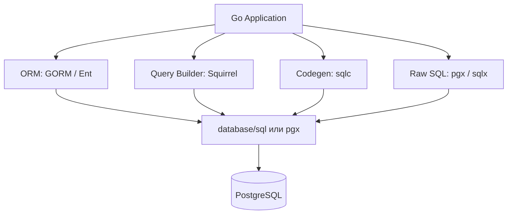
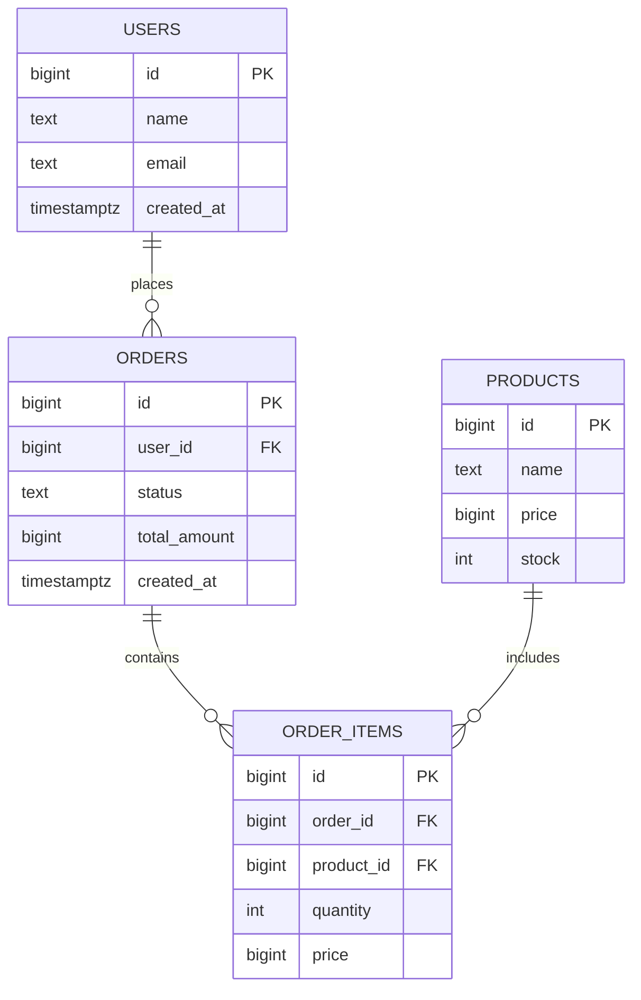
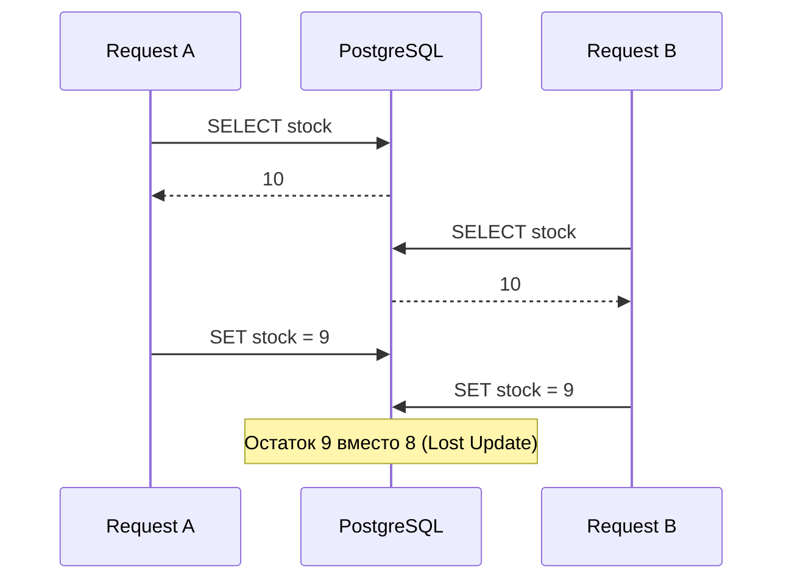
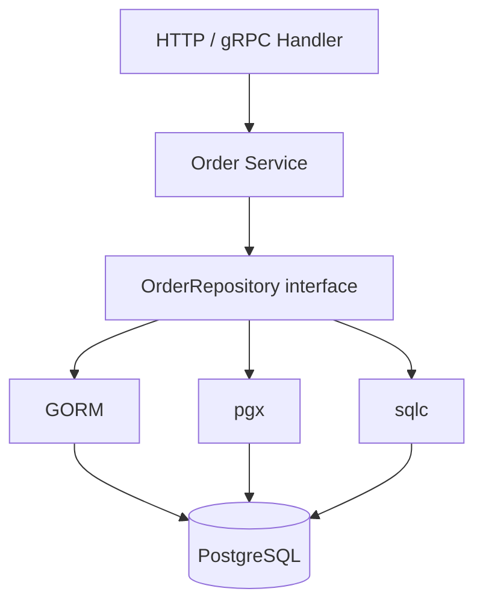

# Go и базы данных: ORM vs SQL

**Контроль, производительность и удобство разработки**

ORM — не зло, SQL — не серебряная пуля. Разработчик должен понимать, какую абстракцию выбирает и какую цену за неё платит.

## 1. Общий план вебинара

Аудитория: Middle и Senior Go-разработчики. Продолжительность: 90 минут.

| Тема | Время |
|---|---:|
| Введение. Зачем нужен ORM | 5 мин |
| Способы работы с БД в Go | 10 мин |
| Один CRUD на разных библиотеках | 15 мин |
| Проблемы ORM в production | 15 мин |
| Транзакции и конкурентный доступ | 10 мин |
| Бенчмарки и профилирование | 15 мин |
| Архитектура слоя доступа к данным | 10 мин |
| Рекомендации и вопросы | 10 мин |

[Заметки ведущего с таймингом и репликами](#заметки-ведущего)

## 2. С чего начать вебинар

- Зачем Go-разработчику ORM, если он знает SQL?
- Можно ли считать разработчика Senior, если он не знает, какие SQL-запросы выполняет его приложение?
- Действительно ли ORM ускоряет разработку?
- Почему сервис прекрасно работает на тестовых данных, но тормозит в production?
- Можно ли написать приложение, вообще не используя SQL?
- Какой процент времени запроса действительно занимает ORM?

Начать с простого получения пользователя через ORM и SQL. По мере усложнения бизнес-логики сравнивать преимущества и недостатки подходов.

## 3. Экосистема работы с базами данных в Go



Упрощённая схема: конкретный драйвер зависит от библиотеки.

| Инструмент | Подход | Особенность |
|---|---|---|
| `database/sql` | Стандартный интерфейс Go | Минимум абстракций |
| `pgx/v5` | PostgreSQL-драйвер | Нативные возможности PostgreSQL |
| `sqlx` | Расширение database/sql | Удобный маппинг структур |
| Squirrel | Query Builder | Динамическое построение SQL |
| sqlc | SQL-first, кодогенерация | Типизированный Go-код из SQL |
| GORM | ORM | CRUD, ассоциации, hooks |
| Ent | ORM с кодогенерацией | Типизированный API |

`sqlc`, `sqlx` и Squirrel — не ORM.

## 4. Демонстрационный проект

Order Service на Go 1.25 и PostgreSQL.



Все четыре библиотеки выполняют чтение пользователя по ID. Отдельные демонстрации показывают загрузку заказов в GORM, динамические фильтры, конкурентное списание, массовую вставку и отчёт по выручке. Колонки с денежными суммами хранят копейки.

## 5. Live Coding: простой CRUD

```go
type User struct {
    ID        int64
    Name      string
    Email     string
    CreatedAt time.Time
}
```

### GORM

```go
func (r *Repository) GetUser(ctx context.Context, id int64) (User, error) {
    return gorm.G[User](r.db).
        Where("id = ?", id).
        First(ctx)
}
```

### pgx

```go
func (r *Repository) GetUser(ctx context.Context, id int64) (User, error) {
    const query = `
        SELECT id, name, email, created_at
        FROM users
        WHERE id = $1
    `
    var user User
    err := r.pool.QueryRow(ctx, query, id).Scan(
        &user.ID, &user.Name, &user.Email, &user.CreatedAt,
    )
    return user, err
}
```

### sqlx

```go
func (r *Repository) GetUser(ctx context.Context, id int64) (User, error) {
    const query = `
        SELECT id, name, email, created_at
        FROM users
        WHERE id = $1
    `
    var user User
    err := r.db.GetContext(ctx, &user, query, id)
    return user, err
}
```

Для sqlx добавить тег `db:"created_at"` к полю CreatedAt.

### sqlc

```sql
-- name: GetUser :one
SELECT id, name, email, created_at
FROM users
WHERE id = $1;
```

```bash
sqlc generate
```

```go
user, err := queries.GetUser(ctx, id)
```

**Вопрос аудитории:** какой вариант проще поддерживать, если в проекте 200 SQL-запросов и 20 разработчиков? sqlc позволяет добиться лаконичности вызывающего кода, сохраняя явный SQL.

## 6. Семь проблем, которые стоит показать на вебинаре

### 6.1. N+1 запросов

```go
db.Find(&users)
for i := range users {
    db.Where("user_id = ?", users[i].ID).
        Find(&users[i].Orders)
}
```

| Пользователи | N+1 | Пакетная загрузка |
|---:|---:|---:|
| 10 | 11 | 2 |
| 100 | 101 | 2 |
| 1000 | 1001 | 2 |

Исправление через GORM:

```go
db.Preload("Orders").Find(&users)
```

GORM загружает пользователей, затем их заказы отдельным запросом с IN. Через SQL можно выполнить два аналогичных запроса или JOIN:

```sql
SELECT u.id, u.name, o.id AS order_id, o.total_amount
FROM users u
LEFT JOIN orders o ON o.user_id = u.id;
```

Обсудить: почему JOIN не всегда быстрее двух запросов, дублирование данных, сетевую задержку, потребление памяти и то, что N+1 возможен без ORM.

### 6.2. SELECT *

```go
db.Find(&users)
```

```sql
SELECT id, name FROM users;
```

```go
db.Select("id", "name").Find(&users)
```

Добавить большое JSONB-поле и сравнить объём данных, время запроса и аллокации Go.

### 6.3. Неочевидное поведение UPDATE

```go
type Product struct {
    ID    int64
    Stock int
}

db.Model(&product).Updates(Product{Stock: 0})
```

GORM при обновлении через структуру по умолчанию пропускает zero values. Чтобы обнулить остаток:

```go
db.Model(&product).Updates(map[string]any{"stock": 0})
```

```sql
UPDATE products SET stock = 0 WHERE id = $1;
```

Обсудить zero value, NULL, отсутствующее значение и PATCH-семантику.

### 6.4. Сложные SQL-запросы

Пять пользователей с максимальной суммой завершённых заказов за последние 30 дней:

```sql
SELECT u.id, u.name, SUM(o.total_amount) AS revenue
FROM users u
JOIN orders o ON o.user_id = u.id
WHERE o.status = 'completed'
  AND o.created_at >= NOW() - INTERVAL '30 days'
GROUP BY u.id, u.name
ORDER BY revenue DESC
LIMIT 5;
```

Усложнить задачу: CTE, оконные функции, ранжирование, JSONB, LATERAL JOIN, UPSERT, рекурсивные запросы. Показать, как ORM-код превращается в SQL внутри цепочек методов. `Raw()` в GORM — нормальный инструмент, но стоит обсудить, для каких операций нужен ORM.

### 6.5. Динамические фильтры

```go
query := sq.
    Select("id", "user_id", "status", "total_amount").
    From("orders").
    PlaceholderFormat(sq.Dollar)

if filter.UserID != nil {
    query = query.Where(sq.Eq{"user_id": *filter.UserID})
}
if filter.Status != "" {
    query = query.Where(sq.Eq{"status": filter.Status})
}
query = query.OrderBy("id DESC").Limit(100)
sql, args, err := query.ToSql()
```

SQL Injection: параметризация значений и whitelist для динамических имён колонок и сортировки.

### 6.6. Массовые операции

```go
// GORM
db.CreateInBatches(products, 1000)
```

```go
// pgx
count, err := pool.CopyFrom(
    ctx,
    pgx.Identifier{"products"},
    []string{"name", "price", "stock"},
    pgx.CopyFromRows(rows),
)
```

| Подход | Количество записей |
|---|---:|
| INSERT в цикле | 100 000 |
| INSERT в одной транзакции | 100 000 |
| Multi-row INSERT | 100 000 |
| GORM CreateInBatches | 100 000 |
| pgx.CopyFrom | 100 000 |

### 6.7. Миграции

Предпочтительны версионируемые SQL-миграции вместо автоматического изменения схемы при запуске приложения.

```text
migrations/
├── 000001_create_users.up.sql
├── 000001_create_users.down.sql
├── 000002_create_orders.up.sql
├── 000002_create_orders.down.sql
├── 000003_add_orders_index.up.sql
└── 000003_add_orders_index.down.sql
```

Обсудить rolling update в Kubernetes, совместимость схем между версиями, блокировки таблиц, создание индексов, воспроизводимость и запуск миграций из CI/CD.

## 7. Транзакции и конкурентный доступ

На складе 10 товаров. Одновременно поступает 100 запросов на покупку.

```go
product, err := repo.GetProduct(ctx, id)
if err != nil {
    return err
}
if product.Stock == 0 {
    return ErrOutOfStock
}
product.Stock--
return repo.UpdateProduct(ctx, product)
```



### Атомарный SQL

```sql
UPDATE products
SET stock = stock - 1
WHERE id = $1 AND stock > 0
RETURNING stock;
```

Ноль обновлённых строк — товар отсутствует или закончился.

### Пессимистическая блокировка

```sql
SELECT id, stock FROM products
WHERE id = $1 FOR UPDATE;
```

Чтение и обновление выполняются в одной транзакции.

### Optimistic locking

```sql
UPDATE products
SET stock = stock - 1, version = version + 1
WHERE id = $1 AND version = $2 AND stock > 0;
```

Для примера требуется дополнительная колонка `version`.

Обсудить Read Committed, Repeatable Read, Serializable; pessimistic и optimistic locking; deadlocks и повтор транзакций; границы транзакции; ошибочное использование глобального DB вместо tx. ORM не решает автоматически проблемы конкурентного доступа.

## 8. Бенчмарки и профилирование

| Инструмент | Назначение |
|---|---|
| Go Benchmark | Время выполнения |
| benchstat | Сравнение результатов |
| pprof | CPU и память |
| Pyroscope | Непрерывное профилирование |
| Testcontainers | Реальная тестовая БД |
| pg_stat_statements | Статистика SQL-запросов |
| EXPLAIN ANALYZE | План выполнения |
| Grafana | Визуализация метрик |

Проект включает бенчмарк GetByID. Остальные строки таблицы подходят для упражнений по расширению набора замеров.

| Бенчмарк | Сценарий |
|---|---|
| GetByID | Получение одной записи |
| List100 | Получение 100 записей |
| List10000 | Получение 10 000 записей |
| Join | Получение связанных данных |
| Insert | Вставка одной записи |
| BulkInsert | Вставка 100 000 записей |
| Parallel | Конкурентные запросы |
| Transaction | Создание заказа |

```go
func benchmarkGetUser(b *testing.B, repo UserRepository) {
    b.Helper()
    b.ReportAllocs()
    ctx := context.Background()
    for b.Loop() {
        _, err := repo.GetUser(ctx, 1)
        if err != nil {
            b.Fatal(err)
        }
    }
}
```

```bash
go test ./benchmarks/... -run='^$' -bench=. -benchmem -benchtime=3s -count=10

go test ./benchmarks -run='^$' -bench=BenchmarkGetUser/gorm -cpuprofile=cpu.out -memprofile=mem.out

go tool pprof -http=:8080 cpu.out
```

### Из чего складывается latency

Условная модель, не результаты измерений:

| Компонент | Время |
|---|---:|
| Подготовка и маппинг Go | 100 мкс |
| Сеть | 500 мкс |
| Выполнение SQL | 1000 мкс |
| Прочее | 100 мкс |
| Итого | 1700 мкс |

Доля подготовки и маппинга: около 5,9%. Изменение сетевой задержки и времени SQL меняет эту долю.

Для честного сравнения обеспечить одинаковые данные, SQL-семантику, размеры пулов, условия кеширования, индексы и границы транзакций. GORM по умолчанию оборачивает операции записи в транзакции — учитывать это при сравнении. Не объявлять победителя заранее.

## 9. Оптимизация SQL важнее выбора ORM

```sql
EXPLAIN (ANALYZE, BUFFERS)
SELECT id, status, total_amount
FROM orders
WHERE user_id = 100
ORDER BY created_at DESC
LIMIT 20;
```

```sql
CREATE INDEX idx_orders_user_created_at
ON orders (user_id, created_at DESC);
```

Повторить запрос и сравнить Sequential Scan и Index Scan, прочитанные страницы, время, обработанные строки и нагрузку на PostgreSQL. Подготовить минимум миллион заказов.

Переписывание ORM на pgx не исправит отсутствующий индекс или неудачный план запроса.

## 10. Архитектура слоя доступа к данным



```go
type OrderRepository interface {
    GetByID(ctx context.Context, id int64) (Order, error)
    List(ctx context.Context, filter OrderFilter) ([]Order, error)
    Create(ctx context.Context, order Order) (int64, error)
    UpdateStatus(ctx context.Context, id int64, status OrderStatus) error
}
```

Антипаттерн универсального репозитория:

```go
type Repository[T any] interface {
    Create(ctx context.Context, entity T) error
    Update(ctx context.Context, entity T) error
    Delete(ctx context.Context, id int64) error
    FindAll(ctx context.Context) ([]T, error)
}
```

Вместо универсального CRUD часто полезнее методы, отражающие намерения бизнес-логики:

```go
ReserveProduct(ctx, productID, quantity)
CancelOrder(ctx, orderID)
FindExpiredOrders(ctx, before)
GetCustomerRevenue(ctx, customerID)
```

Не нужно строить собственный ORM поверх существующего ORM.

## 11. Сравнительная таблица

| Критерий | GORM | pgx | sqlx | sqlc |
|---|---|---|---|---|
| Простота CRUD | Высокая | Средняя | Средняя | Высокая после настройки |
| Контроль SQL | API/Raw | Полный | Полный | Полный |
| Ручной код | Мало | Много | Средне | Мало |
| Проверка типов запросов при генерации | Нет | Нет | Нет | Да |
| Динамические запросы | Удобно | Вручную | Вручную | Ограниченно |
| Ассоциации | Удобно | Вручную | Вручную | Вручную |
| Нативные возможности PostgreSQL | Зависит от API | Отлично | Зависит от драйвера | Через pgx и SQL |
| Предсказуемость SQL | Требует контроля | Высокая | Высокая | Высокая |
| Сложные запросы | API или Raw | Удобно | Удобно | Удобно |
| Генерация Go-кода | Не нужна | Нет | Нет | Да |

## 12. Какой подход выбрать

- **GORM — быстрый старт:** CRUD, административные панели, прототипы, простые операции с сущностями.
- **pgx — максимальный контроль:** highload, сложные транзакции, массовые операции, нативные возможности PostgreSQL.
- **sqlc + pgx — баланс:** production-микросервисы, типизированные запросы, командная разработка, явный SQL без ручного Scan.
- **Squirrel — динамические запросы:** фильтры, поиск, каталоги, отчёты.
- **sqlx — SQL с минимумом инфраструктуры:** явные запросы и удобный маппинг без кодогенерации.

Для новых backend-сервисов с PostgreSQL рассмотреть sqlc + pgx/v5 как основной вариант, Squirrel — для действительно динамических запросов.

## 13. Интерактив с аудиторией

### Вопрос 1. Какова основная причина N+1?

A. Reflection  
B. Отдельный запрос для каждой сущности  
C. Отсутствие индекса  
D. Маленький connection pool

**Ответ: B.** N+1 возникает из-за схемы загрузки данных и возможен при любом инструменте.

### Вопрос 2. Что автоматически делает sqlc?

A. Оптимизирует SQL  
B. Создаёт индексы  
C. Генерирует Go-код на основе SQL и схемы  
D. Управляет миграциями

**Ответ: C.** sqlc генерирует типизированные методы и структуры, но не оптимизирует SQL за разработчика.

### Вопрос 3. Гарантирует ли Read Committed отсутствие Lost Update при произвольном read-modify-write?

A. Да  
B. Нет  
C. Только в ORM  
D. Только в pgx

**Ответ: B.** Нужна атомарная операция, блокировка или другой контроль конкурентного доступа.

### Вопрос 4. Что лучше для массовой загрузки в PostgreSQL?

A. INSERT в цикле с autocommit  
B. SELECT FOR UPDATE  
C. COPY, если подходит семантика  
D. Preload

**Ответ: C.** COPY предназначен для эффективной массовой загрузки.

### Вопрос 5. Что делать первым, если ORM-запрос медленный?

A. Переписать на pgx  
B. Увеличить количество горутин  
C. Добавить Redis  
D. Посмотреть SQL, план выполнения и метрики

**Ответ: D.** Сначала определить реальное узкое место.

## 14. Структура демонстрационного репозитория

- `cmd/demo` содержит сценарии, которые запускаются через `make demo-…`.
- `internal/repository` содержит реализации чтения GORM, pgx, sqlx и sqlc и построитель фильтров Squirrel.
- `internal/dbgen` содержит сгенерированный код sqlc.
- `db` содержит схему, генератор данных, запросы sqlc и сценарий EXPLAIN.
- `benchmarks` содержит сравнение GetUser и интеграционную проверку результатов четырёх реализаций.

Команды подготовки базы и сценарии приведены в [README](../README.md).

## 15. Материалы для самостоятельного изучения

- [GORM Documentation](https://gorm.io/docs/)
- [GORM Performance](https://gorm.io/docs/performance.html)
- [pgx](https://github.com/jackc/pgx)
- [sqlc Documentation](https://docs.sqlc.dev/)
- [sqlx](https://github.com/jmoiron/sqlx)
- [Squirrel](https://github.com/Masterminds/squirrel)
- [PostgreSQL — Using EXPLAIN](https://www.postgresql.org/docs/current/using-explain.html)
- [JetBrains — Comparing database/sql, GORM, sqlx and sqlc](https://blog.jetbrains.com/go/2023/04/27/comparing-db-packages/)

## 16. Анонс вебинара

**Go и базы данных: ORM vs SQL**

Что выбрать для нового Go-сервиса: GORM, чистый SQL, sqlx или sqlc? Насколько ORM влияет на производительность? Когда удобство разработки становится источником проблем в production?

На вебинаре разберём современные подходы к работе с PostgreSQL в Go, реализуем одинаковые операции с использованием разных библиотек, проведём бенчмарки и посмотрим на реальные планы выполнения SQL-запросов.

Обсудим N+1, транзакции, конкурентный доступ, массовые операции, кодогенерацию и архитектуру слоя доступа к данным.

Минимум абстрактной теории — максимум живого кода и практических экспериментов.

**Целевая аудитория:** Middle и Senior Go-разработчики.

**Продолжительность:** 90 минут.

## 17. Финальный слайд

> **Не абстрагируйтесь от базы данных. Абстрагируйтесь от рутинного кода.**

- ORM не заменяет знание SQL.
- SQL не гарантирует производительность.
- Типобезопасность не гарантирует корректность бизнес-логики.
- Измерения важнее предположений.
- Инструмент должен соответствовать задаче.

Три наиболее эффектные живые демонстрации: **N+1, конкурентное списание остатков и сравнение массовой вставки через GORM и pgx.CopyFrom**.

## Заметки ведущего

### Перед эфиром

- Выполните `make up`, `make migrate`, `make seed` и `make test-integration`. Откройте рядом терминал и исходники `cmd/demo/main.go`, `internal/repository/repo.go` и `db/queries/users.sql`.
- Сохраните вывод `make demo-n-plus-one`, `make demo-transactions`, `make demo-bulk` и `make plans`. Заранее прогоните `make bench` и `make profile`. В эфире хватит короткого замера, а полный вывод пригодится для обсуждения повторяемости.
- Если отстаёте от тайминга, оставьте в живом показе N+1, lost update и EXPLAIN. Фильтры и массовую вставку можно разобрать по сохранённому выводу.

### 00:00–00:05 · Вступление

«Эндпоинт замедлился после релиза. У нас есть время проверить только одну вещь. На что вы посмотрите?» Дайте залу ответить. Запишите на доске три величины — количество SQL-запросов на операцию, объём возвращённых данных и время выполнения в PostgreSQL. Возвращайтесь к ним по ходу показа.

### 00:05–00:15 · Где проходит граница абстракции

Попросите назвать, где в каждом варианте видны проекция, аргументы и преобразование строки в Go-структуру. У pgx это видно в SQL и `Scan`, у sqlx отображение задаёт структура, у sqlc связку SQL и типов создаёт генератор, у GORM форму запроса задают модель и вызовы методов. Покажите одну и ту же операцию глазами разработчика, которому завтра надо добавить поле и провести ревью.

### 00:15–00:30 · Один пользователь, четыре реализации

Запустите `make demo-crud` и покажите четыре одинаковых результата. Попросите зал найти одно место, где новая колонка может потеряться. Удобно проследить путь `created_at` через порядок аргументов `Scan`, тег `db`, модель GORM и тип, созданный sqlc.

**Что обсудить.** У четырёх методов общий Go-интерфейс. Какой контракт увидит вызывающий код, если строки с таким ID нет? Посмотрите на ошибки разных реализаций и спросите, где их стоит свести к одному правилу сервиса.

### 00:30–00:45 · Три сюрприза в обычном чтении и записи

- **N+1.** Перед `make demo-n-plus-one` попросите угадать число SELECT для 100 пользователей. В проверенном прогоне цикл сделал 101 запрос, а `Preload` — два. Откройте обе строки SQL из второй части. Спросите, что произойдёт с объёмом данных, если вместо этих двух запросов сделать JOIN и у каждого пользователя 100 заказов. Для ответа достаточно посчитать, сколько раз повторятся поля пользователя.
- **Ширина строки.** В `make demo-select-star` сначала покажите одинаковое число строк, затем байты значений. На подготовленных данных было около 4,15 МБ для полной строки и 15,9 КБ для `id, name`. Это размер значений полей, который считает программа. Время одиночного запуска зависит от окружения.
- **Нулевое значение.** Перед `make demo-zero-values` спросите, что означает `Stock: 0` в PATCH-запросе. После обновления структурой программа выводит `10`, после обновления через map — `0`. Предложите залу различить пропущенное поле, явный ноль и переданный `null`.
- Если остаётся время, покажите вывод `make demo-filters`. Попросите найти, где заканчивается текст SQL и начинаются аргументы. Обсудите, почему параметр подходит для значения статуса, а варианты сортировки удобно задавать явным списком.

### 00:45–00:55 · Две успешные покупки одной единицы

На доске разыграйте два запроса, которые прочитали остаток 10 и оба записали 9. Затем запустите `make demo-transactions`. В наивной ветке все 100 участников читают остаток до первой записи, и программа показывает 100 успешных операций при остатке 9. С атомарным UPDATE проходят 10 операций, остаток становится нулевым.

**Вопрос залу.** «Что добавится к транзакции, если вместе со списанием надо создать заказ и его позиции?» Подведите к одному инварианту: при ошибке второй записи первая тоже должна откатиться. Покажите, где проходит граница транзакции и почему все запросы внутри неё должны использовать тот же `tx`.

### 00:55–01:10 · Разбор замеров

- **План запроса.** В `make plans` начните со строк `Parallel Seq Scan` и `Index Scan`. Затем сравните `Buffers` и число строк, отброшенных фильтром. Спросите, зачем индекс начинается с `user_id` и почему следующим идёт `created_at`. По индексу PostgreSQL может читать подходящие строки в нужном порядке и остановиться после `LIMIT 20`.
- **Go-бенчмарк.** Покажите несколько прогонов `make bench`. Сначала сравните `B/op` и `allocs/op`, затем разброс `ns/op`. Спросите, покажет ли CPU-профиль Go, сколько процессорного времени затратил PostgreSQL. Откройте профиль и сопоставьте его назначение с `EXPLAIN (ANALYZE, BUFFERS)`.
- **COPY.** В `make demo-bulk` обе ветки вставляют по 100 тыс. строк во временные таблицы. Покажите, что GORM получает значения через `RETURNING`, а COPY возвращает число вставленных строк. Спросите, изменится ли выбор, если к каждой исходной записи тут же нужен её сгенерированный ID. Таймер охватывает вставку внутри транзакции, а создание таблицы и коммит происходят за его пределами.

### 01:10–01:20 · Где провести границу репозитория

Дайте задачу «зарезервировать две единицы товара, только если их хватает». Попросите предложить сигнатуру метода и результат при нехватке остатка. Сопоставьте `ReserveProduct(ctx, productID, quantity)` и последовательность `GetProduct` / `UpdateProduct`. Спросите, в каком варианте проще проверить инвариант на ревью и куда поместить границу транзакции, если резервирование включает несколько товаров.

### 01:20–01:30 · Вопросы и завершение

- Возьмите два вопроса из [интерактива](#13-интерактив-с-аудиторией). Для быстрого голосования хорошо работают N+1 и lost update.
- Вернитесь к замедлившемуся эндпоинту из вступления. Попросите каждого назвать первый замер и объяснить, какое решение он позволит принять.
